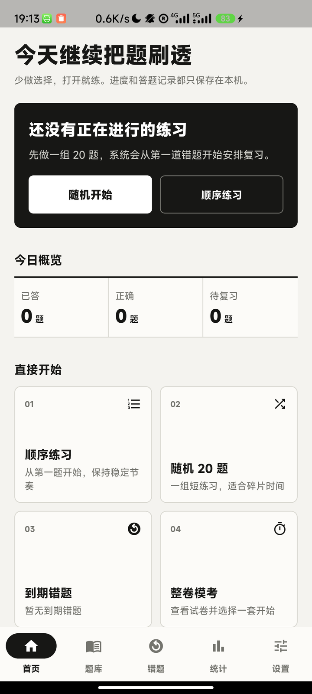
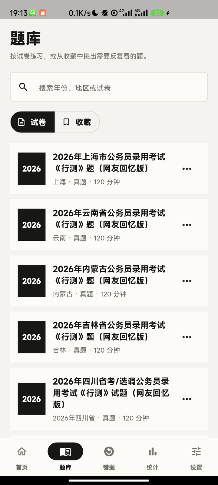
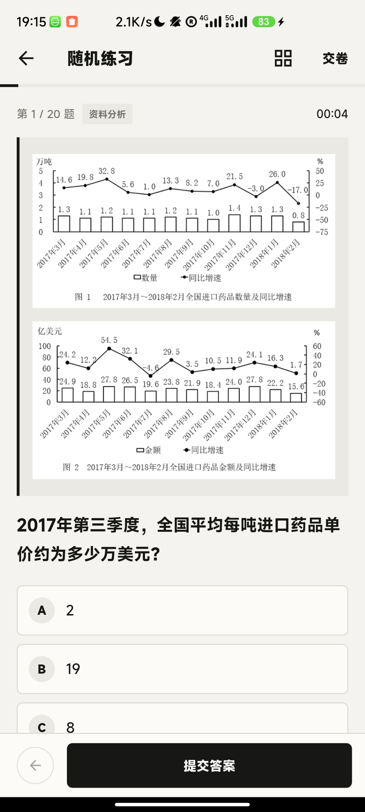
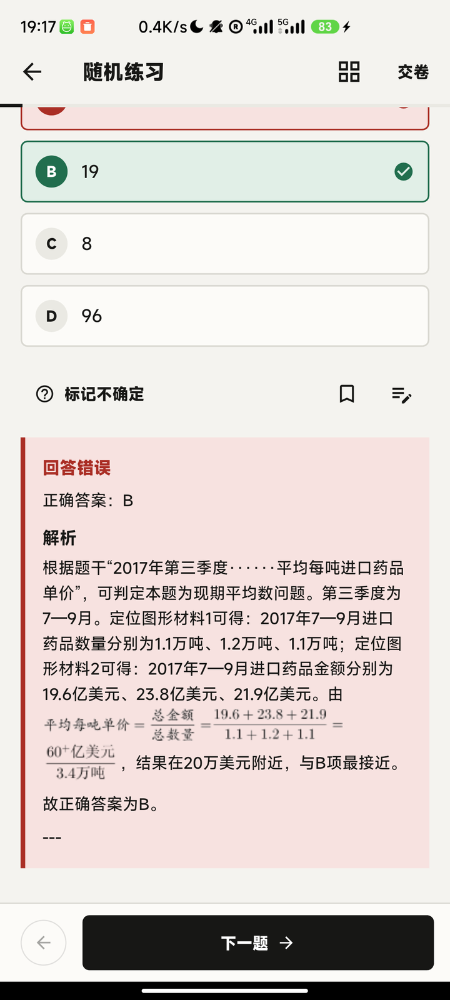
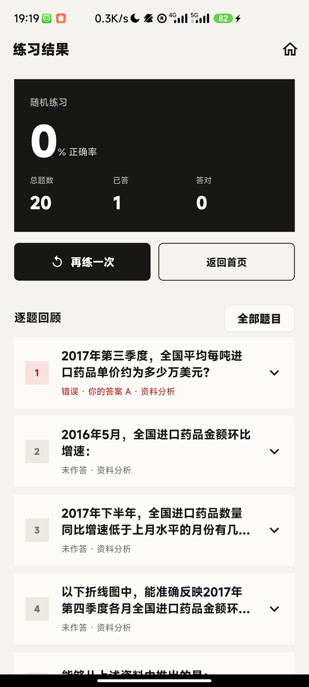

# 狂刷题

**把行测真题装进手机，断网也能刷。不注册、不登录、不埋点，作答记录只留在这台设备上。**

[](https://github.com/xinghe-labs/kuangshuati/actions/workflows/ci.yml)


<table>
  <tr>
    <td align="center"><br><sub>首页 · 今日概览</sub></td>
    <td align="center"><br><sub>题库 · 试卷列表</sub></td>
    <td align="center"><br><sub>资料分析题（带图）</sub></td>
  </tr>
  <tr>
    <td align="center"><br><sub>作答 · 计时</sub></td>
    <td align="center"><br><sub>错题解析</sub></td>
    <td align="center"><br><sub>结果 · 逐题回顾</sub></td>
  </tr>
</table>

<sub>真机 release 构建截图，不是原型图。</sub>

## 下载安装

不想编译源码？从 [Releases](https://github.com/xinghe-labs/kuangshuati/releases) 下载最新签名 APK（当前 v1.1.3，sha256 `0d39385c…`）。应用内更新走 [update-manifest.json](https://kuangshuati.124145.xyz/update-manifest.json)。首次启动在应用内下载题库（约 145 MB，SHA-256 校验后安装），之后全程离线。

### iOS（未签名 ipa，需自行签名）

没有 Mac 也能拿到 iOS 包：[`ios-build.yml`](.github/workflows/ios-build.yml) 每次改动后在 macOS runner 上编译，并把**未签名 ipa** 传进对应版本的 Release —— 和 APK 同一个 Release（例如 `v1.1.2` 里的 `kuangshuati-1.1.2-12-unsigned.ipa`，匿名可下）；发版建 Release 时也会自动补一次。

iOS 只运行签名过的 App，所以这个 ipa **不能直接安装**：需要用 [Sideloadly](https://sideloadly.io/) 等工具，以自己的 Apple ID 重签后侧载。免费 Apple ID 签名的有效期是 7 天，到期重签一次即可（App 内数据保留）。完整步骤、注意事项与常见问题见 [docs/ios-sideload.md](docs/ios-sideload.md)。

> 未签名 ipa 不包含题库（题库仍是首次启动时下载），也不含任何开发者证书。目前不提供 TestFlight / App Store 版本，iOS 真机验收仍在待办中（见 Roadmap）。

## 功能

- **真离线**：题库与题图全部落在本地 SQLite，装好题库断网可用。
- **六种练习入口**：顺序、随机、试卷、错题复习、自定义组卷、整卷模考（含按题库模块占比随机组卷的「随机模考」）；逐题解析或交卷后统一出解析。
- **自定义题库**：导入自己整理的 JSON 题库（支持图片、多选、主观自评题），与官方题库并存，练习记录互不干扰；格式见 [docs/question-bank-format.md](docs/question-bank-format.md)；App 内「设置 → 导入题库 → 查看格式与示例」也有一份可复制的最小示例。
- **完整闭环**：作答 → 判题 → 解析 → 结果 → 错题入册 → 到期复习；中断后能接着上次的进度继续。
- **统计与备份**：作答统计、最近练习正确率、`.gkbackup` 备份与恢复。
- **体验细节**：资料分析题图内联排版、深色模式跟随系统、键盘作答与快捷键、模考倒计时自动交卷。

## 隐私承诺

- **没有账号体系**：不注册、不登录，App 不知道你是谁。
- **数据只在本机**：没有云同步，卸载即清除；要迁移就用 `.gkbackup` 备份文件，它由你自己保管。
- **无埋点**：依赖清单里没有任何第三方统计或广告 SDK，全部依赖可公开审计。
- **网络只用于两件事**：首次下载题库包（SHA-256 校验）和应用内检查更新，仅此而已。

## Roadmap

- [x] Android 正式发布（v1.1.3）
- [x] iOS 未签名 ipa：CI 构建，自备 Apple ID 自行签名侧载（见 [docs/ios-sideload.md](docs/ios-sideload.md)）
- [ ] iOS 正式分发（TestFlight / App Store）：代码同构，CI 已做编译验证；缺 Apple Developer 证书，上架时间待定
- [ ] 题库内容更新：应用内已支持版本检查，公开的更新节奏待定

---

以下内容面向开发者。

## 快速开始

环境要求：Flutter 3.44.1（CI 使用同一版本）、Dart ^3.12.1。

```bash
git clone https://github.com/xinghe-labs/kuangshuati.git
cd kuangshuati/app
flutter pub get
flutter run
```

测试：

```bash
flutter test
```

依赖真实题库的集成测试在拿不到题库分片时自动跳过，所以无需私有资源即可跑通全部测试。

## 项目结构

```
app/                  # Flutter 应用主体
  lib/core/           # 基础设施（配置、常量、工具）
  lib/data/           # 数据层（drift/SQLite、题库下载、备份）
  lib/domain/         # 领域模型与业务逻辑
  lib/features/       # 按功能划分的页面与状态（practice、papers、stats…）
  lib/shared/         # 跨功能共享的组件
docs/                 # 内容清单示例、自定义题库格式文档与示例
.github/workflows/    # CI（静态分析+测试）、iOS 编译验证
```

## 题库数据

题库数据**不在本仓库内**。这里有两个容易混的 JSON，用途完全不同：

| 文件 | 用途 |
| --- | --- |
| [`docs/content-manifest.example.json`](docs/content-manifest.example.json) | **官方题库包的清单**。应用首次启动按它下载题库包，普通用户不用管。 |
| [`docs/question-bank-format.md`](docs/question-bank-format.md) | **自定义题库的导入格式**。自己整理题库时看这个，可导入的完整示例见 [`docs/question-bank.example.json`](docs/question-bank.example.json)。 |

导入入口在「设置 → 导入题库」，里面两个选项：「选择 JSON 文件」直接导入，「查看格式与示例」给出必填字段与可复制的最小示例。

## 许可证与题库版权

- 代码以 [Apache License 2.0](LICENSE) 发布。
- 题库来源于公开数据的整理与汇总，权利归原出处所有。题库仅随 App 以个人学习用途提供，请勿转售或再分发。

## 反馈与贡献

- **遇到问题**：到 [Issues](https://github.com/xinghe-labs/kuangshuati/issues/new/choose) 提。Bug 模板会问版本号、安装方式和题库来源——这三项决定了能不能复现。
- **想加功能**：先说清场景，不必先想好方案。
- **安全漏洞**：不要开 Issue，走 [SECURITY.md](SECURITY.md) 的私密渠道。
- **想用自己整理的题库**：不用改代码，见 [docs/self-host-content.md](docs/self-host-content.md)。
- **想提 PR**：读 [CONTRIBUTING.md](CONTRIBUTING.md)。代码欢迎；题库内容不接收，版权不属于本项目。

## English

**Kuangshuati** ("Crazy Drills") is an offline-first Flutter app for practicing the aptitude section (行测 / xingce) of China's civil-service exam. No account, no sign-in, no analytics — your answers never leave your device. The full question bank (one-time in-app download, ~145 MB, SHA-256 verified) lives in local SQLite, and everything works fully offline afterwards: six practice modes, error review, mock exams with countdown auto-submit, cross-device backup via `.gkbackup` files. Source is open under Apache-2.0 — grab the Android APK from [Releases](https://github.com/xinghe-labs/kuangshuati/releases), and iOS compiles in CI with an unsigned ipa artifact that you can self-sign with your own Apple ID (see [docs/ios-sideload.md](docs/ios-sideload.md); a signed release is still pending).

---

## 🔗 Friend Links

- 🐧 [**LinuxDO**](https://linux.do)
