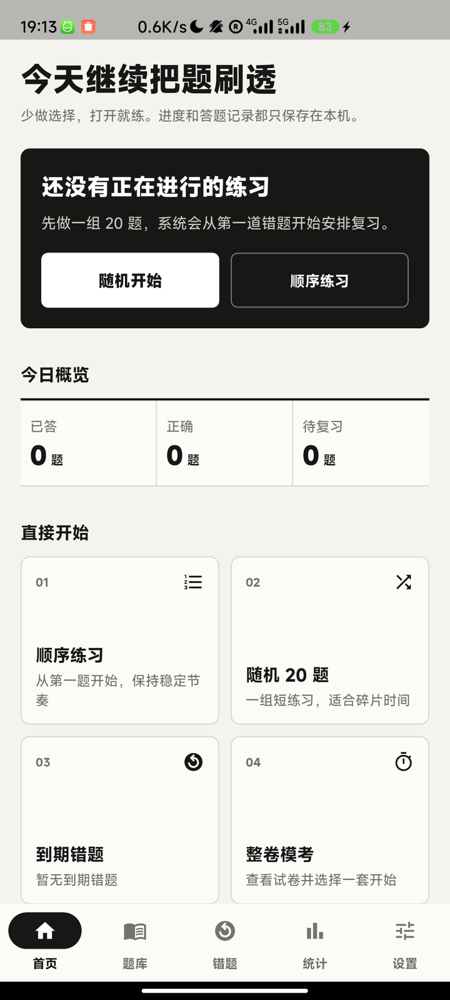
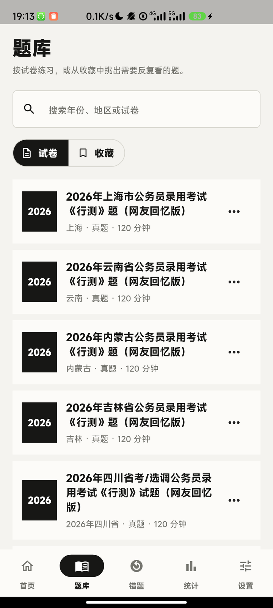
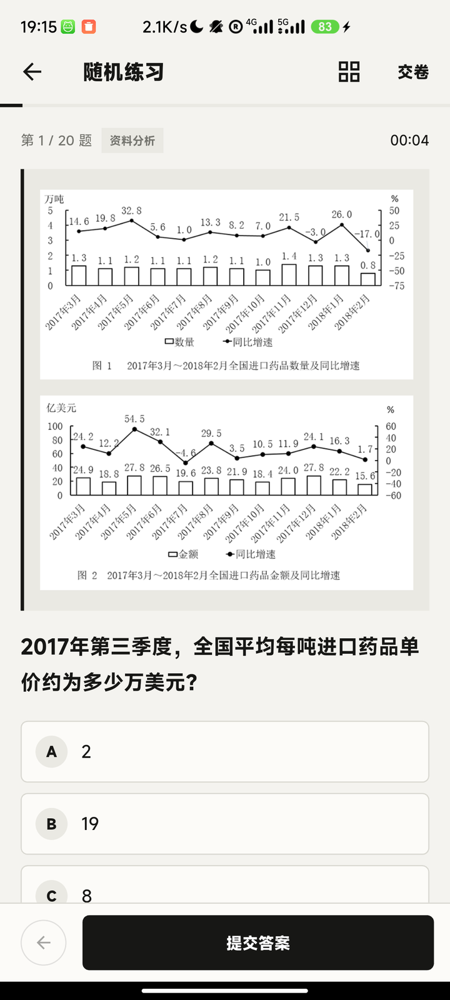
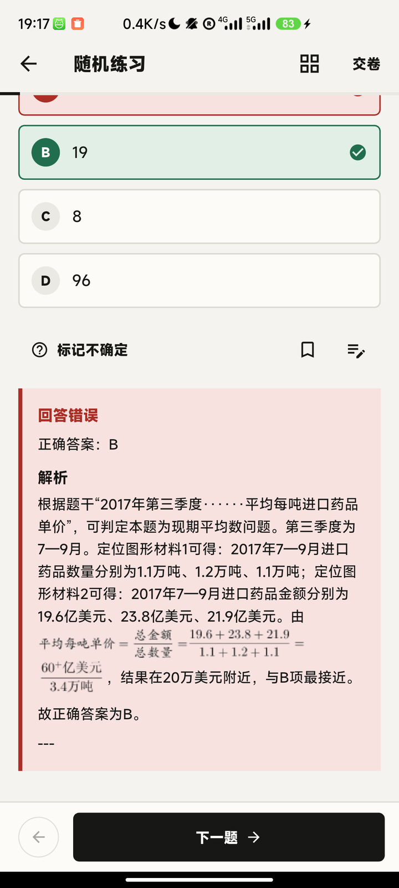
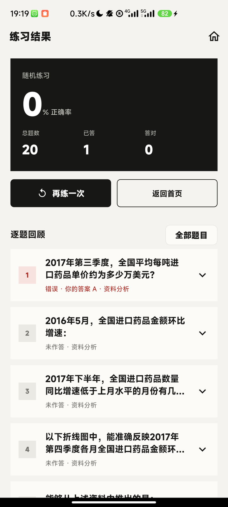

# 狂刷题

**把 5.8 万道行测真题装进手机，断网也能刷。不注册、不登录、不埋点，作答记录只留在这台设备上。**


<table>
  <tr>
    <td align="center"><br><sub>首页 · 今日概览</sub></td>
    <td align="center"><br><sub>题库 · 515 套试卷</sub></td>
    <td align="center"><br><sub>资料分析题（带图）</sub></td>
  </tr>
  <tr>
    <td align="center"><br><sub>作答 · 计时</sub></td>
    <td align="center"><br><sub>错题解析</sub></td>
    <td align="center"><br><sub>结果 · 逐题回顾</sub></td>
  </tr>
</table>

<sub>截图来自真机上的 release 构建，不是原型图。</sub>

## 它能做什么

- **真离线**：58,890 道题、515 套试卷、39,196 张题图放在本地 SQLite（约 297 MB），装好题库后全程不需要网络。
- **六种练习入口**：顺序练习、随机练习、试卷练习、错题复习、自定义组卷、整卷模考。
- **两种答案时机**：逐题解析，或交卷后统一出解析。
- **完整闭环**：作答 → 判题 → 解析 → 结果 → 错题入册 → 下一组；中断后能接着上次的进度继续。
- **错题本与收藏**：到期复习队列、掌握标记、笔记与收藏分离。
- **统计与备份**：作答统计、最近练习正确率、跨端 `.gkbackup` 备份与恢复（原生端与 Web 端互导已实测）。
- **细节**：资料分析题图内联排版、深色模式跟随系统、键盘作答与快捷键、模考倒计时与自动交卷。
- **本地优先**：没有账号体系、没有云同步、没有第三方埋点 SDK（`pubspec.yaml` 里没有 analytics 依赖，代码里没有上报逻辑）。

## 快速开始

```bash
git clone <repo>
cd app
flutter pub get
flutter run          # 零配置：debug 构建自动启用内置演示题库（12 道题 / 5 份演示卷）
```

演示题库是仓库自带的示例题，**只够跑通交互，不是真实题量**。要换成完整题库有两条路：

**A. 接自己的题库包**（格式见 `release/content-manifest.json`）

```bash
flutter run --dart-define=CONTENT_MANIFEST_URL=https://your-host/content-manifest.json
```

首次启动会下载、校验 SHA-256 并安装题库包，之后离线使用。

**B. 自己生成题库包**：`tools/import_question_bank.py` 从 JSONL 构建带图的 SQLite 内容库，`tools/build_content_package.py` 负责切片、压缩和清单生成。

> 需要验证真实下载流程时，用 `--dart-define=KUANGSHUATI_DEMO=false` 关掉演示题库兜底。

### Web 端

```bash
python tools/build_web.py     # 构建 app/build/web，含核心题库
python tools/serve_web.py     # 默认 http://127.0.0.1:8080，--lan 可让同 Wi-Fi 手机访问
```

浏览器端用 OPFS + SQLite WASM，**必须带 `Cross-Origin-Opener-Policy: same-origin` 和 `Cross-Origin-Embedder-Policy: require-corp` 响应头**（`serve_web.py` 已带），否则 `crossOriginIsolated` 为 false，数据库 worker 起不来。注意浏览器可能在存储压力下清理 OPFS 数据，重要进度请用备份导出。

## 架构

```text
ui/          可直接在浏览器打开的移动优先交互原型（HTML/CSS/JS）
app/         Flutter 客户端（Android 已验证，iOS 仅编译验证）
  lib/data/content/     内容库读取：分片安装、只读 SQLite、题图 BLOB
  lib/data/database/    用户数据（作答、错题、收藏、笔记）—— drift，与内容库物理隔离
  lib/features/         首页 / 题库 / 练习 / 错题 / 统计 / 设置
tools/       题库导入、内容包构建、发布脚本
docs/        需求发现、开发文档、UI 规范
```

几个刻意的取舍：

- **内容库与用户库分离**。题库更新只替换内容库，作答记录不会丢。
- **题库按 16 MiB 分片下发**。避免把 297 MB 一次性读进内存，也支持并发分片下载（并发数换带宽，实测 24 路 1.54 MB/s vs 2 路 0.27 MB/s）。
- **不做账号和云同步**。用本地文件备份替代跨设备合并，省掉一整套服务端和隐私面。
- **不为了显得功能多加社区、排行榜、金币、AI 对话**。

## 测试

```bash
cd app
flutter analyze     # 无问题
flutter test        # 126 个测试通过
```

覆盖组件渲染（含题图内联/块级分流）、数据库、备份恢复、更新包校验、多选题判分、空白题不入错题本、收藏与笔记分离、深色色表切换、演示题库兜底等回归用例。依赖真实题库分片的集成测试在拿不到分片时会自动跳过，所以公开仓库的 CI 不需要私有资源。

CI 配置见 `.github/workflows/ci.yml`。

## 题库不随附（请先读这条）

- **本仓库只开源代码，不包含题库数据。** 仓库里没有任何一道真实题目的正文、解析或题图。
- 完整题库的题目、解析、图片版权归原出处，本项目**没有**获得公开分发授权，因此不随仓库、也不随 Release 分发。
- 内置的 12 道演示题是自写的示例数据，仅用于跑通交互。
- 题库基线（题量、去重后的图片数、内容库大小）写在 [docs/development-plan.md](docs/development-plan.md)，供自行构建时对照。

## 已知限制

- **iOS**：只有编译验证（`.github/workflows/ios-build.yml`），没有签名和真机包。
- **Windows 桌面**：没有验证过，本机缺 Visual Studio 构建链。
- **Web 端**：首次要装约 187 MB 核心题库，弱网体验一般；OPFS 可能被浏览器清理。
- **演示题库**：12 道题，只能验证交互，不能用来评估做题体验。
- **图片类题目**：题库里 2 张源图缺失，保留缺图状态而不是静默删题。
- 在 Windows 上跑 `flutter test` 偶发 `sqlite3.dll` 拒绝访问，是 native-assets 构建缓存被残留测试进程占用，关掉残留 `dart.exe`/`flutter_tester.exe` 重试即可。

## 文档

| 文件 | 内容 |
|---|---|
| [docs/requirements-discovery.md](docs/requirements-discovery.md) | 用户视角需求发现与发布边界 |
| [docs/development-plan.md](docs/development-plan.md) | 技术架构、数据模型、同步与离线策略、测试 |
| [docs/ui-spec.md](docs/ui-spec.md) | 信息架构、视觉系统、页面状态、无障碍与验收记录 |
| [ui/index.html](ui/index.html) | 浏览器可直接打开的交互原型 |

## 许可证

代码以 [Apache License 2.0](LICENSE) 发布。题库数据不在许可范围内（见上文）。
